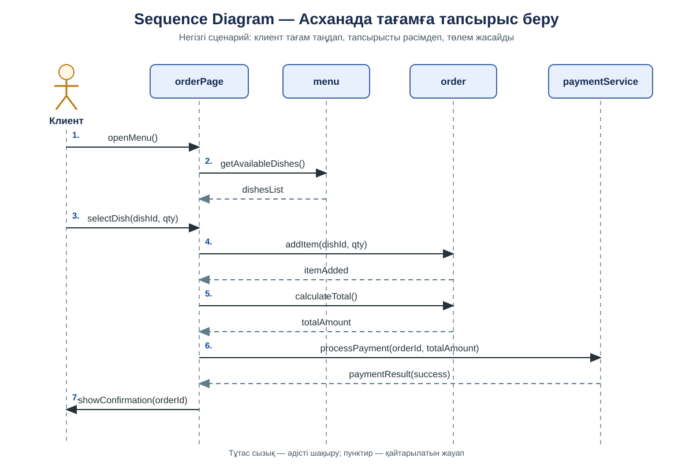

# Қазбек — мен туралы және Git тәжірибесі

Менің атым Қазбек.
Мен бағдарламалауды үйреніп жүрмін.
Git және GitHub арқылы жобаларымды басқаруды үйренемін.

Бұл README файлы GitHub-та жаңартылды.

## Конфликтті шешу

README бірінші жолы `main` және `feature-title` тармақтарында әртүрлі өзгертілді. Терминалда `main` тармағында `git merge feature-title` орындалып, нақты `CONFLICT (content)` шықты. Конфликт белгілері алынып, ортақ тақырып сақталды; `git add README.md` және `git commit` арқылы merge аяқталды.

Орындалу журналы: [docs/git-merge-conflict.txt](docs/git-merge-conflict.txt). Бұл тәжірибе Codex бұлттық Linux ортасында орындалды.

## Командалық жұмыс

Бұл жол өз репозиторийімдегі [№3 PR](https://github.com/k9121110-stack/kazbek/pull/3) арқылы қосылды. Ол PR жұмысын жеке жаттығу ретінде көрсетеді.

Оқытушының рұқсатымен екі аккаунтты бір студент басқаратын тәжірибе орындалды. Екі репозиторийде де қарсы аккаунт collaborator ретінде қосылып, шақырулар қабылданды.

- Негізгі аккаунт `embergenkazbek-rgb/about-me` репозиторийін clone жасап, `add-comment` тармағында README-ге жол қосты, commit + push орындады. [Жіберілген №1 PR](https://github.com/embergenkazbek-rgb/about-me/pull/1) екінші аккаунтпен қабылданды.
- Екінші аккаунт осы репозиторийдің `add-comment` тармағында README-ге жол қосып, [№4 PR](https://github.com/k9121110-stack/kazbek/pull/4) ашты. Өзгеріс тексеріліп, негізгі аккаунт атынан merge жасалды.

Негізгі аккаунттан clone, commit және push Codex Cloud Linux терминалында орындалды. Кері өзгеріс пен PR екінші аккаунттың GitHub веб-интерфейсінде жасалды.

## GitHub-пен жұмыс

Бұл бөлім 4-практикалық тапсырма үшін GitHub репозиторийінде жаңартылды. Өзгерісті жергілікті компьютерге `git pull origin main` командасымен алуға болады.

GitHub сайтындағы жаңа өзгеріс: 4-тапсырмадағы git pull тәжірибесін тексеру.
Екінші аккаунттан README-ге пікір қосып, бірлескен GitHub жұмысын тексердім.

## 4-жұмыс: Sequence Diagram

**Прецедент:** «Асханада тағамға тапсырыс беру жүйесі».

**Актор:** Клиент — тапсырысты бастайтын сыртқы пайдаланушы.

**Объектілер (тапсырма талабындағы :ClassName пішімі):**

- `:OrderPage` — мәзірді көрсетіп, клиент әрекеттерін қабылдайтын интерфейс.
- `:Menu` — қолжетімді тағамдар тізімін беретін объект.
- `:Order` — таңдалған тағамдарды, санын және жалпы соманы сақтайтын объект.
- `:PaymentService` — төлемді өңдеп, нәтижесін қайтаратын қызмет.

Диаграмма клиенттің мәзірді ашуын, тағам таңдауын, тапсырысқа қосуын, жалпы соманы есептеуін және төлем жасауын көрсетеді. Әр объектінің атауы кестедегі талапқа сай `:ClassName` пішімімен берілген. Өңдеуге болатын бастапқы файл: [04-sequence.drawio](04-sequence.drawio). Нөмірлер шақыру ретін көрсетеді; пунктир көрсеткілер жауаптарды білдіреді.

Диаграмма файлы: [docs/sequence-diagram.svg](docs/sequence-diagram.svg).
